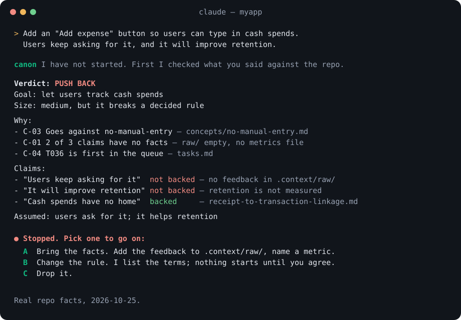

<p align="center">
  
</p>

<h1 align="center">canon</h1>

<p align="center"><b>See your usage and prompt cache above the prompt.</b> Turn on the rest only if you want it.</p>

A new install of canon does one thing: it adds a band above the Claude Code
prompt. It adds no skills, no startup text and no search server. In our test it
added no startup tokens at all.

```
☼  $1.20                                      M  7D 41%  5H 96%  ctx 62%  ↻ 53m +$0.17
```

- **Awake:** ☼ is off; a click turns it into a green ☀ that keeps this Mac and its screen awake while the session is open.
- **Reply size:** S, M or L. A click moves to the next size, and it goes beside each prompt, so the cache holds.
- **Usage left** in your 7-day and 5-hour windows, with the reset time when it runs low, and the room left in the context window.
- **Prompt cache:** how long it stays warm, and what your next message costs once it goes cold. One click restarts the hour; the label shows the cost first.
- **Click to see what it means:** each short item explains itself in one line, which closes by itself.

Everything else is off until you turn it on for a repo. Free and MIT.

## Install

```bash
claude plugin marketplace add ritesh-firodiya/canon-cli
claude plugin install canon@canon
```

That is the whole band. To turn on anything else, you also need the CLI:

```bash
npm install -g @freetesh/canon
```

## Turn on what you want

Run this in a repo, or add the name to `features:` in `.context/context.yaml`.
`canon disable <feature>` turns it off again.

```bash
canon enable process
```

| Feature | What you get | Startup tokens added |
|---|---|---|
| `process` | The decision gate, decisions, standards, learning from history, ideas with wildcards, and your stage, gates, runs and checks on the band | about 550 |
| `knowledge` | Search and answers from your repo's knowledge, with a local index of one collection per product | about 600 |
| `routing` | Effort and model picked for each prompt, shown on the band, and you can override it | none |

A feature only affects the repo you enable it in. To turn one on across your
machine, in every repo and any other folder, add `--user`:
`canon enable routing --user`. A session started in a parent folder does not load a
repo's plugins, so use `--user` if you work that way.

### `process`: facts, not assumptions

<p align="center">
  
</p>

- **Weigh before acting.** For a non-trivial request Claude checks the
  constitution, the wiki and decisions, features and tasks, cost against value,
  and the write-less ladder, then answers **DO IT**, **DO IT DIFFERENTLY** or
  **PUSH BACK** with citations. Try `/canon-process:weigh add a dark mode toggle`.
- **No assumptions.** Each claim in a request ("users want this", "it is slow")
  is checked against the repo and its data sources and marked backed or not.
- **Your data sources, your tools.** A repo describes each tool that holds its
  data on a `SOURCE.*` wiki entity that names the MCP server, skill or CLI that
  reads it. The gate queries it read-only to back or reject a claim.
- **Decisions in one place.** `/canon-process:decision` writes one file per topic,
  overwritten when the choice changes. `tasks.md` holds open work only, and history is git's.
- **Weigh is enforced.** A prompt sized large changes nothing until weigh has run.
- **Learn from history.** `/canon-process:learn` reads `canon learn` and proposes rule changes where people keep overriding a rule. It changes nothing until you decide.
- **More ideas.** `/canon-process:wildcard` makes 2 of every 10 ideas break your patterns.

### `knowledge`: found before Claude answers

Every repo's wiki and feature board is indexed with
[QMD](https://github.com/tobi/qmd), and Claude searches before answering. Ask with
`/canon-knowledge:ask`; `/canon-knowledge:ingest` with no argument captures what a session taught.

```bash
npm install -g @tobilu/qmd --allow-scripts=node-llama-cpp,tree-sitter-go,tree-sitter-python,tree-sitter-rust,tree-sitter-typescript,tree-sitter-javascript
```

### The knowledge gate: always on in a product repo

Before Claude writes a page under `.context/`, the band runs `canon gate`: every rule the repo
has, on the repo as it is and as it would be with the page. A page that repeats a fact from
another page, lacks its frontmatter or breaks a cap is refused, and Claude is told to fix it or
bring it to you.

### `routing`: the right effort for each prompt

Haiku sorts each typed prompt as small, medium or large, through your own login.
Effort follows every prompt, because that keeps the cache. The model is picked at
the start of a session and then only moves up, because a change reloads the chat.
Your choice on the band, or `/model`, always wins. `canon learn --cost` shows the counts
and what deciding cost. Headless sessions and `canon run` agents are never routed.

## Commands you run

A command runs only when you type it. These need no feature turned on:

- **`canon learn`** shows what history says: verdicts and the rule changes they propose; `--cost` shows what your sessions used and would cost at list prices, by skill, tool, model and product.
- **`canon check`** fails when a repo breaks its rules: layout, wiki frontmatter, stale pages, size caps, blocked tasks,
  feature pages, dead paths, prices with no canonical home, the import architecture, pipeline gates and your own checkers. `canon hooks install` runs it on every push.
- **`canon run`** moves a record through its pipeline with an agent, stopping at each gate and spend cap.
- **`canon check --standards`** shows the defaults and library a repo imports by name (`standards: [design-sets, pipeline]`).

A hosted knowledge site, with every repo's `.context/` in one place for a team,
is a separate paid product built on this CLI.

## All commands

```bash
canon init             # write .context/context.yaml and the missing .context files
canon add              # list packs; `canon add expo` adds one and indexes its docs
canon gate <file>      # a page on stdin, judged by every rule before it is written (the band runs it)
canon check            # this repo against the standards (exit 1 on any error); --all for every repo beside it
canon hooks install    # a pre-push hook that runs `canon check` (--all: every product)
canon check --status   # version, kind, modules, config layers, check summary
canon check --standards   # which standards apply here, and where each comes from
canon check --copies   # shared files against copies.source (--sync repairs the drifted ones, never adds one)
canon update           # update the CLI and the Claude plugin, then refresh: packs, search index, pinned version, models
canon update --refresh # only the refresh, installing nothing
canon models           # the models this machine can run and their prices
canon doctor           # node, git, qmd — plus any tools your config lists
canon learn            # verdicts, and the rule changes overrides propose (--json for the learn skill)
canon new <kind> <t>   # start a page from its template: problem, idea, plan, finding, ...
canon records          # what each kind, status and priority means here
canon queue            # open work, most urgent first, and what it waits for
canon reject <stage> --record <id> --note <why>   # a person sends any stage back; it and later stages run again
canon set <record> field=value   # change a field, checked against the rules
canon done <record>    # mark it complete
canon new experiment <name> --from <stage>   # a named experiment, from any stage
canon run <record>     # move a record through its pipeline with an agent; stops at gates and caps
canon trigger [id]     # read connectors, open problems, join repeats (--run works on new ones)
canon verdict          # put a weigh verdict on the record it judged
canon approve <stage> --record <id>   # a person approves a stage on a record, in a terminal
canon pipeline         # the stages this repo resolves to, and where each stands
canon ui               # this repo's design set on localhost, with canon's shell
canon wiki             # every product wiki on localhost
canon learn --flow <product>   # how far each local Claude conversation got against the pipeline (--write: metrics/flow.json)
canon learn --cost     # what local Claude sessions used and cost at list prices (--skill <name>, --unused, --json, --save)
canon band             # the facts the band above the Claude Code prompt shows, as JSON
canon enable <feature> # turn on process, knowledge or routing for this repo (canon disable turns it off)
```

## Config

Every repo carries its own rules in `.context/context.yaml`; nothing above the repo
is read. An uncommitted `context.local.yaml` beside it overrides it on one machine.
Commands that span products (`--all`, `ui`, `learn`) use the folder that
holds the repo you are in, or `CANON_WORKSPACE`.

```yaml
# <repo>/.context/context.yaml — written by `canon init`
canon: 0.18.0
kind: mobile                        # mobile | web | mobile-and-web | package | content
standards: [design-sets, pipeline, expo]   # canon's library standards this repo follows; ./rules adds a folder of its own
modules: [docs, knowledge, code, listing, refs]
packs: [expo]
name: Acme                          # how the product is written; `named` copies swap it in
features: [routing]                 # what this repo turns on; only the band is on by default
formerly: [acme-old]                # older folder names, so `canon learn --flow` counts their conversations
extends: [../rules/team.yaml]       # organization, product and team rules; the closest wins
product: acme                       # repos naming one product act as one
team: growth
cap: 5                              # dollars per stage, unless a stage sets its own
pipelines:                          # `default` is canon's flow until you change it; add your own
  default:
    - { id: code, verify: [sentry, "https://app.example.com"] }   # check the real source first
    - { id: review, gate: true }
  hotfix:
    - { id: fix, by: agent, cap: 2 }
locked: [pipelines.default.review]  # a lower layer cannot change this
connectors:                         # your tools, read-only; keys stay in .env
  - { id: sentry, via: cli }
  - { id: acme-erp, via: api, target: https://erp.example.com, env: [ACME_ERP_TOKEN] }   # your own
records:                            # add, change or remove record kinds
  - { folder: plans, fields: { timeline: date-range, owner: remove }, required: [timeline] }
  - { folder: campaigns, prefix: CAMP, statuses: [draft, live], sections: [Goal] }
triggers:                           # what opens a Problem; source is a connector, manual or schedule
  - { id: new-error, source: sentry, when: a p0 error, pipeline: hotfix, cap: 2 }
commands:                           # your own checkers, run by `canon check`
  - { id: lint-copy, run: ./scripts/lint-copy.sh, if: .context/designs, module: design }
copies:                             # files copied from one source repo, kept equal to it
  source: ../design-system
  use: [upload, shell-web]          # sets the source names under its own copies.sets
```

```yaml
# ../design-system/.context/context.yaml — the source names its sets
copies:
  sets:
    upload: [scripts/upload.mjs]
    shell-web:
      - { from: designs/mobile/index.html, to: designs/web/index.html, named: true }
```

Built in, for every repo: a mobile or web repo keeps `.context/designs/` (designs
first), and a repo that draws its screens always gets the design checks.

Lists of names (`packs`, `standards`, `copies.use`) add up across the two files;
`commands`, `doctor.tools`, `wiki.types`, `context.folders` and `context.rootFolders` merge by name.
`context.rootFolders` (`{ folder, reason }`) declares a tracked root folder canon leaves alone; today only `docs` is checked.

## Layout

```
.claude-plugin/   plugin manifest and marketplace
hooks/            the band: the only thing on by default
plugins/          what `canon enable` adds per repo: canon-process (weigh, decision, standards, learn, wiki-lint, wildcard, challenger, constitution), canon-knowledge (ask, ingest)
standards/        default standards
packs/            vendor doc packs
templates/        files init writes (dependency-cruiser base and starters)
evals/            plugin evals on a fixture product
cli/              the canon CLI (TypeScript, vitest); `@freetesh/canon/api` for tools built on it
```

Inside `cli/src/`:

```
index.ts          the program: registers every command
api.ts            what other tools import (`@freetesh/canon/api`)
setup/            init, update, doctor, features (enable/disable), models
know/             packs, the refresh of packs and the search index
enforce/          checks (one file per check; index.ts lists them), the gate, standards, status
work/             records, pipeline and gates, run and trigger
learn/            learn, flow, usage: what history says
serve/            ui, wiki, the band's facts
config/           .context/context.yaml: schema and loading
lib/              shared helpers: files, frontmatter, env, qmd, transcripts, system calls, moved commands
```

Each feature folder holds its logic and a `<command>.command.ts` per command (options and output only).
Tests mirror it in `cli/test/`.

## Develop

`pnpm check` runs `canon check` on this repo, the typecheck and every test.
The version lives in `package.json` and `.claude-plugin/plugin.json`; bump both
with a CHANGELOG entry. A push to main with a new version publishes to npm.

MIT licence.
