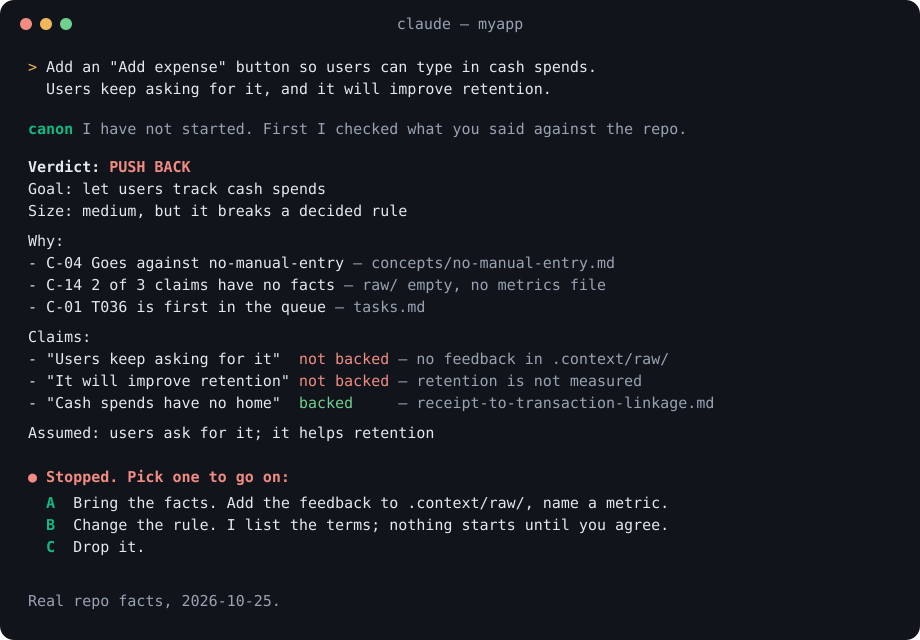

<p align="center">
  
</p>

<h1 align="center">zeno</h1>

<p align="center">
  <b>Facts, not assumptions.</b> Your rules, kept in your repo. Enforced.<br>
  A Claude Code plugin and CLI · MIT
</p>

<p align="center">
  <a href="https://www.npmjs.com/package/@freetesh/zeno"></a>
  <a href="LICENSE"></a>
</p>

zeno keeps your domain knowledge, decisions and AI rules in your own repos, and
enforces them. Claude searches them before it answers. It weighs each request
against them before it acts, and it checks every claim in the request against
facts. `zeno check` fails when code or docs break a rule. The AI guesses less,
and you redo less work.

<p align="center">
  
</p>

It has two halves that read the same config:

- **a Claude Code plugin** — skills, a decision gate, a session hook and a
  search server, so every session in every repo starts with the same rules;
- **the `zeno` CLI** — set up, check, sync and browse your repos.

## What it does

- **Weigh before acting.** For a non-trivial request Claude checks the
  constitution, your wiki and decision records, existing features and tasks,
  cost vs value, and the write-less ladder, then answers **DO IT**, **DO IT
  DIFFERENTLY** or **PUSH BACK** with citations. Push back stops work until you
  give a reason. Every verdict is logged; `zeno learn` shows how often the gate
  stops you and turns repeated overrides into proposals.
- **No assumptions.** A request is not a fact. Each claim in it ("users want
  this", "it is slow") is checked against the repo and its data sources and
  marked backed or not. Work that rests on an assumption stops until you agree
  to written, numbered terms. Replies use plain words.
- **Your data sources, your tools.** zeno has no connectors. A repo describes
  each tool that holds its data (Sentry, Datadog, Snowflake) on a `SOURCE.*`
  wiki page that names the MCP server, skill or CLI that reads it. The gate
  queries it, read-only, to back or reject a claim, and `zeno check` fails a
  source page that does not say how to read it.
- **Knowledge that is found, not remembered.** Every repo's `.context/wiki` and
  feature board is indexed with [QMD](https://github.com/tobi/qmd) (local hybrid
  search). Claude is told to search before answering.
- **Standards with one home.** zeno ships defaults (constitution, wiki schema,
  `.context` layout, agent contract). A team adds or replaces them from its own
  folder; a repo can override again. `zeno standards` shows what applies.
- **Hard rules are checks.** `zeno check` validates layout, wiki frontmatter,
  stale pages, placeholder text, page and `tasks.md` size caps, blocked tasks,
  feature pages, the store listing tree, dead `.context/` paths, prices with no
  canonical home, files shared across products, and runs every checker your
  config declares. `zeno hooks install` makes every push run it.
- **Context stays small.** A line belongs in `.context/` only if an agent would
  get something wrong without it. Decisions are one file per topic, overwritten
  when the choice changes; `tasks.md` holds open work only; history is git's.
- **Stages stop at their gates.** A `pipeline:` in `zeno.yaml` lists your
  stages in order, with the paths that show each has started. A gated stage
  needs a person to run `zeno approve <stage>` before any later stage starts;
  `zeno check` fails otherwise. Approvals are dated in
  `.context/raw/zeno/gates.jsonl`, so you can see where work waits. A product
  replaces the estate's pipeline by declaring its own.
- **Each repo's architecture is enforced.** With the `architecture` module, a
  repo keeps its own import rules in `.dependency-cruiser.cjs` files: one at the
  root, or one per workspace under `apps/` and `packages/` (each runs from its
  folder, since apps map `@/` to their own `src`). `zeno init` writes starters and
  `.dependency-cruiser.base.cjs`, the shared base they extend; that base is zeno's,
  and `zeno sync` keeps it current. Add `dependency-cruiser` as a devDependency.
  `zeno check` fails on a broken boundary or a cycle, the gate weighs requests
  against the rules, and `zeno ui` draws each repo's import graph.
- **Products evolve together.** Packs index vendor docs (`llms.txt`) for a stack;
  `zeno sync` refreshes them and moves each repo to the current zeno version.

## Install

```bash
# plugin (from GitHub)
claude plugin marketplace add ritesh-firodiya/zeno
claude plugin install zeno@zeno

# CLI (Node 22+)
npm install -g @freetesh/zeno

# search
npm install -g @tobilu/qmd --allow-scripts=node-llama-cpp,tree-sitter-go,tree-sitter-python,tree-sitter-rust,tree-sitter-typescript,tree-sitter-javascript

# optional: write-less discipline for the efficiency step of the gate
claude plugin marketplace add DietrichGebert/ponytail && claude plugin install ponytail@ponytail
```

## Quickstart (5 minutes)

In any git repo, after the install above:

```bash
zeno doctor                 # node, git, qmd — fix anything marked ✗ first
zeno init                   # pick kind, modules and doc packs; writes .claude/zeno.yaml and .context/
zeno check                  # should print "<repo>  ok"
zeno sync                   # fetches the packs you picked and indexes the wiki for search
```

Then start Claude Code in the repo. The session hook loads the constitution,
and a non-trivial request is weighed before Claude acts on it — try
`/zeno:weigh add a dark mode toggle`. Write decisions to `.context/wiki/` as
you make them (`/zeno:decision`) and ask about them later with `/zeno:ask`.

Want import rules too? `zeno init --force --modules docs,knowledge,architecture`
(keep the modules you already had), `npm i -D dependency-cruiser`, then edit the
starter `.dependency-cruiser.cjs` to your layers. `evals/fixtures/streaks` is a
small product with a wiki and decision records, if you want to see the
`.context/` layout before touching your own repo.

## CLI

```bash
zeno init             # write .claude/zeno.yaml and the missing .context files (asks kind, modules, packs)
zeno init -y --kind web --modules docs,code --packs nextjs   # same, no questions
zeno add              # list packs; `zeno add expo` adds one and indexes its docs (-g: whole estate)
zeno check            # this repo against the standards (exit 1 on any error)
zeno check --all -q   # every repo in the estate, only the ones with findings
zeno copies --sync    # overwrite drifted shared files from copies.source (never adds one)
zeno hooks install    # a pre-push hook that runs `zeno check` (--all: every product)
zeno standards        # which standards apply here, and where each comes from
zeno sync             # refresh pack docs + search index, move the pinned zeno version, then check
zeno status           # version, kind, modules, config layers, check summary
zeno doctor           # node, git, qmd — plus any tools your config lists
zeno learn            # proposals from overridden verdicts; --approve/--reject <id>
zeno weigh "<ask>"    # the decision gate from the terminal (runs Claude, weighs only)
zeno ui               # every wiki (search, backlinks, graph) on :4610, design galleries on :4611
```

## Config

`.claude/zeno.yaml`, read in layers — **estate → repo → local**
(`zeno.local.yaml`, not committed). The estate is the nearest folder above a
repo whose `zeno.yaml` says `estate: true`, or `ZENO_ESTATE`.

```yaml
# <estate>/.claude/zeno.yaml — shared by every repo below it
estate: true
standards: [.zeno/standards]        # team rules; same name replaces a zeno default
commands:                           # your own checkers, run by `zeno check`
  - id: designs
    run: ./scripts/check-designs.sh
    if: .context/designs            # only where this path exists
doctor:
  tools:
    - { tool: pnpm, why: product scripts, hint: npm i -g pnpm }
wiki:
  types:                            # added to the built-in folders (concepts, entities, decisions, surfaces, synthesis)
    - type: postmortem
      folder: postmortems
      reason: incidents need a timeline and a fix
      sections: [Summary, Timeline, Root cause, Fix, Sources]   # zeno check requires each `## ` heading
context:
  folders:                          # added to the ten .context folders
    - { folder: research, reason: interview notes, kept apart from raw/ }
copies:                             # files every product copies from one source repo
  source: charades                  # a folder beside the estate config
  files:
    - scripts/play-upload.mjs       # same path; a product carries it or skips it
    - { from: .context/designs/mobile/index.html, to: [.context/designs/mobile/index.html, .context/designs/web/index.html], named: true }
    - { from: .context/designs/mobile/shared.css, to: [.context/designs/mobile/shared.css], until: "PALETTE — " }
```

```yaml
# <repo>/.claude/zeno.yaml — written by `zeno init`
zeno: 0.11.0
kind: expo-app                      # expo-app | web | content
modules: [docs, knowledge, code, listing]   # all optional; design is added when .context/designs exists, metrics only when asked
packs: [expo]
checks:
  stale-copies: { enabled: false, reason: "Cursor is still used here" }
weigh:
  weights: { C-05: 2 }
name: Chitragupt                    # how the product is written; `named` copies swap it in
copies:
  skip:                             # shared files this product does without, or keeps its own of
    - { file: scripts/release-android.mjs, reason: built on EAS from a tag }
```

Scalars: the most specific layer wins. `packs` and `standards` add up across
layers; `commands`, `doctor.tools`, `wiki.types` and `context.folders` merge
by name. Built-in types and folders cannot be removed or redefined. A check turned off must
carry a `reason:`, and `zeno check` lists every override.

## Standards

| zeno default | What it holds |
|---|---|
| `constitution.md` | Principles C-01–C-15 a request is weighed against. A team adds C-20+ in its own `constitution.md`. |
| `wiki-schema.md` | What belongs in the wiki, its folders, decisions, frontmatter and size caps |
| `context-layout.md` | The `.context/` ten-folder layout, `features/` and `tasks.md` (open work only) |
| `agent-contract.md` | What every agent does before, during and after work |

## Packs

`packs/<name>/pack.yaml` names the vendor docs to index. Shipped: expo,
uniwind, react, nextjs, firebase, revenuecat. A pack is three lines of YAML; add
your own.

## Evals

`evals/` runs nine requests against a fixture product (`evals/fixtures/streaks`)
with and without the plugin, each in a sandbox seeded with the fixture and a
local QMD index:

```bash
claude plugin eval . --scaffold --mocks off --allow-tools 'mcp__plugin_zeno_qmd__*' Write Edit --runs 2
```

## Layout

```
.claude-plugin/   plugin manifest and marketplace
skills/           weigh, standards, ask, ingest, decision, wiki-lint
agents/           challenger — independent second opinion for too-large requests
hooks/            session start: constitution titles, qmd refresh
standards/        default standards
packs/            vendor doc packs
templates/        files init writes: dependency-cruiser base (synced) and starters
scripts/          log-verdict.mjs — append-only verdict log
cli/              the zeno CLI (TypeScript, vitest; built to cli/dist for npm)
evals/            plugin evals and the fixture product
```

## Develop zeno

Link the repo as a skills-dir plugin so edits apply on the next session:
`ln -s "$PWD" ~/.claude/skills/zeno`.
Run the CLI from source (Node 23.6+ runs the TypeScript directly):
`pnpm install && ln -s "$PWD/cli/src/index.ts" ~/.local/bin/zeno`.
`pnpm test`, `pnpm typecheck` and `pnpm build` run from the repo root.

**Releasing.** Bump `version` in `package.json` and `.claude-plugin/plugin.json`,
then push or merge to `main`. The `release` workflow runs the tests, publishes
`@freetesh/zeno` to npm, tags `vX.Y.Z` and creates the GitHub release. A push
without a bump releases nothing. It needs the `NPM_TOKEN` Actions secret.
